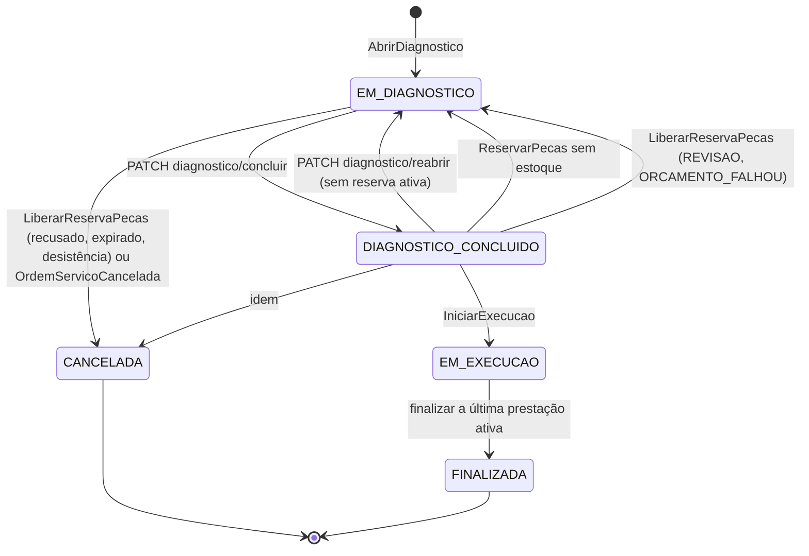
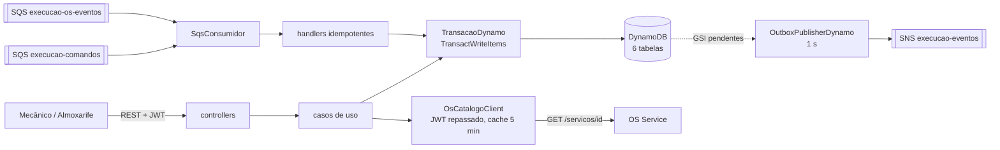
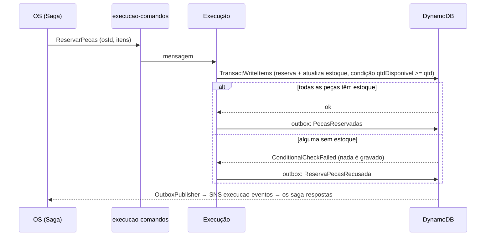

# fiap-soat-mecanica-execucao

[](https://sonarcloud.io/summary/new_code?id=fiap-postech-soat-lf_fiap-soat-mecanica-execucao)
[](https://sonarcloud.io/component_measures?id=fiap-postech-soat-lf_fiap-soat-mecanica-execucao&metric=coverage)

Microsserviço **execucao** da **Fase 4** da Oficina Mecânica do Braia (Tech Challenge FIAP SOAT).

Veja também o [diagrama geral da arquitetura](https://github.com/fiap-postech-soat-lf/fiap-soat-mecanica-k8s/blob/main/docs/arquitetura-fase4/diagrama/arquitetura-aws-fase4.png). Vídeo da entrega: *link entra depois do upload*.

## Responsabilidade

O Execução é o dono do **diagnóstico, da execução do serviço e do estoque de peças**:

- a ordem de execução de cada OS, com prestações de serviço e alocações de peças;
- o catálogo de peças e o estoque, com **reserva atômica** (ou reserva todas as peças da OS, ou nenhuma);
- a fila de execução do mecânico, já ordenada por prioridade;
- o tempo médio por serviço;
- o lado do Execução na Saga da OS: responde aos comandos `AbrirDiagnostico`, `ReservarPecas`, `LiberarReservaPecas` e `IniciarExecucao`, e consome o evento `OrdemServicoCancelada`.

Os dados ficam em 6 tabelas DynamoDB próprias (nenhum outro serviço lê essas tabelas). Orçamento, pagamento, OS e cliente são de outros serviços (ADR-F4-01).

## Arquitetura

- Spring Boot 3.5, Java 21 (virtual threads), arquitetura hexagonal: `domain/`, `application/`, `adapters/in|out/`, `config/`.
- Autenticação: JWT RS256 emitido pelo Identity, validado aqui também (defesa em profundidade). Públicos só `/actuator/health/**`, o Swagger e `/error`.
- Persistência: DynamoDB, com a `TransacaoDynamo` no papel do `@Transactional` (um único `TransactWriteItems` por caso de uso ou handler).
- Mensageria: AWS SDK v2 direto (SNS e SQS), com outbox transacional e consumidor idempotente, em variante DynamoDB (só neste serviço).
- Integração síncrona: `OsCatalogoClient` (Execução → OS), com repasse do JWT, retry e cache.
- Observabilidade: logs JSON com `correlationId`, métricas OTLP e agente OpenTelemetry injetado no EKS (Datadog).

```
REST (mecânico, almoxarife) ──► controllers ──► casos de uso ──┐
                                                               ├──► TransacaoDynamo ──► DynamoDB (6 tabelas)
mecanica-execucao-comandos ──┐                                 │     negócio + outbox + idempotência
mecanica-execucao-os-eventos ┴─► SqsConsumidor ──► handlers ───┘
                                                                          │
SNS mecanica-execucao-eventos ◄── OutboxPublisherDynamo (1 s) ◄───────────┘
OsCatalogoClient ──► GET /servicos/{id} no OS (JWT repassado, cache de 5 min)
```

## API

As rotas de prestação e alocação levam o `osId`, porque o DynamoDB não indexa elementos de lista. A tabela completa, com os erros, está em `docs/contratos/rotas.md` do `-k8s`.

| Rota | Perfil |
|---|---|
| `GET /execucoes/fila?size&cursor` | MECANICO |
| `GET /execucoes/{osId}` | MECANICO ou ALMOXARIFE |
| `POST /execucoes/{osId}/prestacoes` (`{servicoId, precoMaoDeObra}` → 201) | MECANICO |
| `PATCH /execucoes/{osId}/prestacoes/{id}/inativar` · `/finalizar` | MECANICO |
| `POST /execucoes/{osId}/prestacoes/{id}/pecas` (`{pecaId, quantidade}` → 201; não mexe no estoque) | ALMOXARIFE |
| `PATCH /execucoes/{osId}/alocacoes/{id}/inativar` | ALMOXARIFE |
| `PATCH /execucoes/{osId}/diagnostico/concluir` · `/reabrir` | MECANICO |
| `GET /execucoes/tempo-medio[?servicoId=]` | MECANICO |
| `POST /pecas`, `PUT /pecas/{id}`, `GET /pecas/{id}`, `GET /pecas` | ALMOXARIFE |

Não há rota para iniciar a execução: ela começa pelo comando `IniciarExecucao`, depois da aprovação do orçamento. Erros: 404 (ordem desconhecida), 422 (regra de negócio e `SERVICO_INVALIDO`), 409 `CONFLITO_CONCORRENTE` (o cliente repete), 502 `INTEGRACAO_OS` e 503 `OS_INDISPONIVEL`.

Swagger: `/execucao/swagger-ui.html` (via Traefik) ou `/swagger-ui.html` (local).

## Estados da ordem



A fila de execução (`GET /execucoes/fila`) mostra as ordens ativas por prioridade: `EM_EXECUCAO` (1), `DIAGNOSTICO_CONCLUIDO` (2) e `EM_DIAGNOSTICO` (3), e depois pela data de abertura. `FINALIZADA` e `CANCELADA` saem da fila.

## Modelagem DynamoDB e reserva atômica

Resumo da [RFC-F4-02](https://github.com/fiap-postech-soat-lf/fiap-soat-mecanica-k8s/blob/main/docs/arquitetura-fase4/rfc/RFC-F4-02-modelagem-dynamodb-execucao.md), que parte dos padrões de acesso.

| Tabela | Chave | Guarda |
|---|---|---|
| `execucao-ordens` | `osId` | a ordem inteira, como documento (prestações e alocações aninhadas, `comandosAtendidos`, `versao`). GSI esparso `fila` |
| `execucao-pecas` | `pecaId` | `qtdEstoque`, `qtdReservada` e `qtdDisponivel` |
| `execucao-reservas` | `osId` + `pecaId` | quantidade e status (`ATIVA`, `BAIXADA`, `LIBERADA`) |
| `execucao-outbox` | `id` | mensagens a publicar. GSI esparso `pendentes`; TTL |
| `execucao-idempotencia` | `messageId` | mensagens já processadas; TTL de 7 dias |
| `execucao-tempos` | `servicoId` | `totalMinutos` e `amostras` (média por serviço) |

**Estoque materializado:** o invariante é `qtdEstoque = qtdDisponivel + qtdReservada`. Uma condition expression do DynamoDB compara, mas não faz conta, então `qtdDisponivel` é gravado. A reserva faz:

```
SET qtdDisponivel = qtdDisponivel - :n, qtdReservada = qtdReservada + :n
CONDITION qtdDisponivel >= :n AND #status = :ativo
```

As quantidades são somadas por `pecaId` antes da transação (uma transação não toca o mesmo item duas vezes). O `Update` de cada peça, o `Put` da linha de reserva, a atualização da ordem, a outbox e a idempotência vão no mesmo `TransactWriteItems`: ou todas as peças são reservadas, ou nenhuma. Quem perde a corrida pela última unidade recebe um conflito, relê o estoque (agora zerado) e responde `ReservaPecasRecusada`.

**Teste de concorrência:** o `ReservaConcorrenteIT` põe duas ordens para reservar a última unidade ao mesmo tempo (duas threads), em 10 rodadas. Em cada uma, exatamente um `PecasReservadas` e uma `ReservaPecasRecusada`, com `qtdDisponivel = 0`, `qtdReservada = 1` e `qtdEstoque` inalterado. O `ReservaAtomicaIT` prova o "tudo ou nada" com uma peça que tem estoque e outra que não tem.

**Devolução sem duplicar:** só o `LiberarReservaPecas` devolve o estoque, com a reserva `ATIVA → LIBERADA` condicional. O `OrdemServicoCancelada` apenas tira a ordem da fila, para o estoque não voltar duas vezes (`CancelamentoIT`, nas duas ordens de chegada).

**Seed:** as 3 peças do monolito entram por um `ApplicationRunner` (`SeedPecas`) com `Put` condicional, ligado por `app.seed.pecas.enabled`. Pelo Terraform, cada `apply` devolveria o estoque ao valor inicial.

## Mensagens

Contratos produzidos em `docs/contratos/` e consumidos em `src/test/resources/contratos-consumidos/` (copiados do `-os`; o `ContratosConsumidosTest` desserializa cada exemplo no record do handler). Regra de congelamento em `docs/contratos/convencoes.md` do `-k8s`.

| Consome | Fila | Handler |
|---|---|---|
| `AbrirDiagnostico`, `ReservarPecas`, `LiberarReservaPecas`, `IniciarExecucao` (comandos do OS) | `mecanica-execucao-comandos` | um `*Handler` por tipo, em `adapters/in/messaging/` |
| `OrdemServicoCancelada` (evento do OS) | `mecanica-execucao-os-eventos`, pela assinatura filtrada por `type` | `OrdemServicoCanceladaHandler` |

| Publica (tópico `mecanica-execucao-eventos`) | Quando |
|---|---|
| `DiagnosticoAberto` | `AbrirDiagnostico` |
| `DiagnosticoConcluido` | `PATCH …/diagnostico/concluir` |
| `PecasReservadas` · `ReservaPecasRecusada` | `ReservarPecas` |
| `ReservaPecasLiberada` | `LiberarReservaPecas` |
| `ExecucaoIniciada` | `IniciarExecucao` |
| `ExecucaoFinalizada` | finalização da última prestação ativa |

**Idempotência e reemissão (F4-h, F5-h):** o `ProcessadorMensagemDynamo` registra o `messageId` na mesma transação do handler (`Put` condicional, TTL de 7 dias): uma duplicata é concluída sem efeito. Como o OS reenvia comandos com `messageId` novo, o item da ordem também guarda `comandosAtendidos[tipo] = {ids, resposta}`. Um comando cujo `messageId` ou `causationId` está na cadeia de ids é um reenvio: a resposta guardada é reemitida num envelope novo, sem efeito de negócio. Um comando fora da cadeia é uma nova rodada da Saga e substitui a entrada. Um `LiberarReservaPecas` sem reserva ativa responde `ReservaPecasLiberada` mesmo assim, porque o OS manda esse comando "por garantia" no timeout da reserva.

**Conflitos:** conflito de versão ou de estoque faz o processador repetir o handler até 3 vezes, com nova leitura. Depois disso, a mensagem volta para a fila, e no 5º recebimento vai para a DLQ.

**Publicação:** o `OutboxPublisherDynamo` roda a cada 1 s, lê o GSI `pendentes` e reserva cada linha com um *lease* condicional de 30 s antes de publicar. A entrega é pelo menos uma vez, e uma duplicata eventual é absorvida pela idempotência do OS.

## Catálogo de serviços (Execução → OS)

O `POST /execucoes/{osId}/prestacoes` valida o serviço em `GET /servicos/{id}` do OS, **repassando o JWT do mecânico** (`RepasseAutorizacaoInterceptor`). Timeout de 2 s e retry de 3 tentativas (200 ms × 2, só em I/O, timeout ou 5xx), sem circuit breaker. Só respostas 200 entram no cache de 5 min. Serviço inexistente ou inativo → 422 `SERVICO_INVALIDO`; retries esgotados → 503 `OS_INDISPONIVEL`; 401/403 do OS → 502 `INTEGRACAO_OS`. A chamada nunca parte de um handler de mensagem (não haveria token para repassar). Ver ADR-F4-09.

## Configuração

| Propriedade | Variável | Padrão / origem |
|---|---|---|
| `app.security.jwt.public-key` | `JWT_PUBLIC_KEY` | `app_config` (SSM do Identity) |
| `app.os.base-url` | `APP_OS_BASE_URL` | DNS do cluster (`http://mecanica-os.mecanica.svc.cluster.local:8080`) |
| `app.messaging.consumidor.enabled` | — | `true` |
| `app.messaging.consumidor.filas` | `APP_MESSAGING_CONSUMIDOR_FILAS` | URLs de `execucao-comandos` e `execucao-os-eventos` |
| `app.messaging.dlqs` | `APP_MESSAGING_DLQS` | URLs das 2 DLQs |
| `app.messaging.destinos.execucao-eventos` | `MESSAGING_DESTINO_EXECUCAO_EVENTOS` | ARN do tópico |
| `app.outbox.lease` · `lote` · `ttl-publicada` | — | `PT30S` · `25` · `P1D` |
| `app.idempotencia.ttl` | — | `P7D` |
| `app.os.catalogo.cache-ttl` | — | `PT5M` |
| `app.seed.pecas.enabled` | — | `true` |

## Como rodar localmente

```bash
docker compose -f ../fiap-soat-mecanica-k8s/local/docker-compose.yml up -d   # LocalStack e Postgres
./mvnw spring-boot:run -Dspring-boot.run.profiles=local
curl localhost:8084/actuator/health
```

Para o catálogo de serviços, suba também o OS (`:8082`) e, para o login, o Identity (`:8081`). Token de dev: `../fiap-soat-mecanica-k8s/local/jwt/gerar-token-dev.sh ALMOXARIFE`. Com ele, `GET localhost:8084/pecas` devolve as 3 peças do seed.

## Testes e qualidade

```bash
./mvnw verify   # unitários + integração (LocalStack), JaCoCo ≥ 80% de linhas
```

Os ITs sobem um LocalStack (SNS, SQS e DynamoDB) e um único contexto Spring. O `./mvnw verify` do PR do T05 teve 365 testes e 98,1% de cobertura de linhas. O CI (`ci / build`) roda os testes e a análise no SonarCloud (`fiap-postech-soat-lf_fiap-soat-mecanica-execucao`) com espera do Quality Gate.

## Deploy e `infra/`

O CD (`servico-cd.yml@v1`) roda após o CI verde na `main`: `terraform apply` do `infra/` → imagem no ECR → ConfigMap/Secret → `kubectl apply` dos manifestos `k8s/` → rollout e smoke do health. Com o EKS desligado, termina verde sem deploy.

O `infra/` cria o ECR, as 6 tabelas DynamoDB, o tópico `mecanica-execucao-eventos`, as filas `mecanica-execucao-comandos` e `mecanica-execucao-os-eventos` (cada uma com DLQ) e os parâmetros SSM que o OS lê. A assinatura `os-eventos → execucao-os-eventos` fica no `infra/` do OS, por exceção (ADR-F4-03). Contrato com o CD e lista de recursos em [`infra/README.md`](infra/README.md).

## Decisões

ADRs transversais e RFCs no `-k8s` (`docs/arquitetura-fase4/`): ADR-F4-03 (SNS + SQS), ADR-F4-04 (outbox e consumidor idempotente), ADR-F4-05 (database per service), ADR-F4-09 (REST síncrono) e RFC-F4-02 (modelagem DynamoDB). Decisões só deste serviço ficam em `docs/adr/`.

## Componentes e fluxo da reserva



A reserva é uma única transação: ou reserva todas as peças da OS, ou nenhuma.



## Exemplos de `curl`

`API` é a URL do API Gateway (`aws ssm get-parameter --name /mecanica/auth/api-url --query Parameter.Value --output text`). Os usuários e a senha do seed estão no `V5__seed.sql` do Identity.

```bash
TOKEN=$(curl -s -X POST "$API/auth/login" -H 'Content-Type: application/json' \
  -d '{"email":"mecanico@mecanica.test","senha":"Senha@123"}' | jq -r .accessToken)

# 1. Fila de execução do mecânico (já ordenada por prioridade)
curl -s "$API/execucoes/fila?size=20" -H "Authorization: Bearer $TOKEN"

# 2. Adiciona o serviço do catálogo à ordem (o Execução valida no OS)
curl -s -X POST "$API/execucoes/$OS_ID/prestacoes" -H "Authorization: Bearer $TOKEN" \
  -H 'Content-Type: application/json' \
  -d '{"servicoId":"77777777-7777-7777-7777-777777777777","precoMaoDeObra":80.00}'

# 3. Conclui o diagnóstico (a Saga reserva as peças e pede o orçamento)
curl -s -X PATCH "$API/execucoes/$OS_ID/diagnostico/concluir" -H "Authorization: Bearer $TOKEN"
```

Uma collection Postman com todos os serviços está em [`docs/postman/` do `-os`](https://github.com/fiap-postech-soat-lf/fiap-soat-mecanica-os/tree/main/docs/postman).
